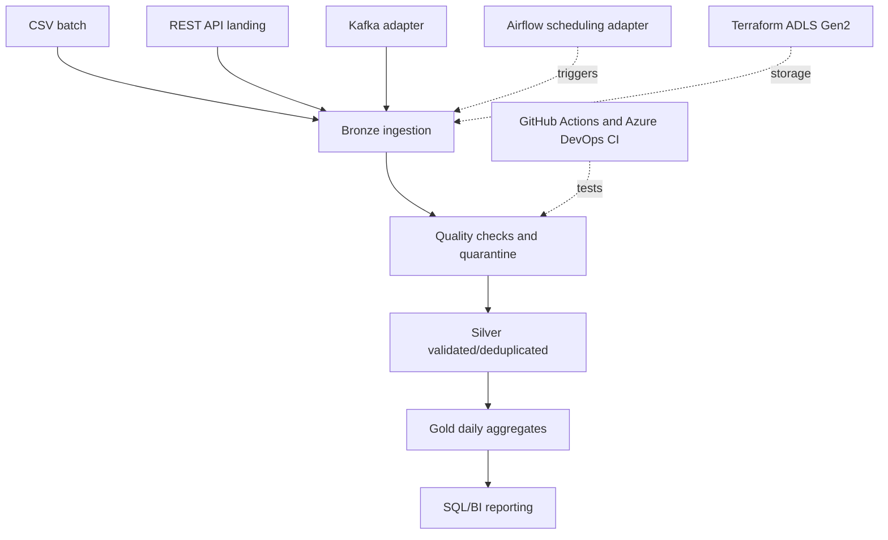

# ADR-001 — Medallion ingestion, cost-conscious Delta design and operations

Status: source implementation and local tests available; optional Azure, Kafka, Airflow, REST and Spark adapters are not verified live.

## Design
Batch/REST/Kafka -> schema validation/quarantine -> Bronze raw -> Silver deduplicated records -> Gold daily KPIs. Output can be served from SQLite locally or Delta on Databricks.

## Why medallion?
Separates fidelity-preserving raw records from quality-controlled facts and downstream business aggregates. Gives a reproducible recovery point and sensible data contracts. Requires storage budget and lineage controls across layers.

## Join tuning
A broadcast join is appropriate only when a dimension side is small and fits worker memory; larger or skewed tables require shuffle strategies. Profile Spark UI SQL stage metrics and skew. Avoid relying only on static estimated bytes.

## Partitioning vs Z-ORDER
Partition on coarse, frequently filtered, low-cardinality values such as months where files stay reasonably sized. Avoid partitioning by customer IDs. Delta Z-ORDER colocates rows on high-selectivity filter columns within files (on classic Delta layouts), requiring OPTIMIZE cost and periodic maintenance; compare with Databricks liquid clustering features where available. Do not assume either technique improves every query.

## Cost and capacity strategy
Start with small autoscaling clusters and sample workloads; scale based on shuffle spill, CPU, memory, p95 time, throughput and DBUs. Limit concurrent jobs and idle time, use job clusters/auto-termination, and compare median query time versus DBUs consumed. Do not claim any cloud cost percentage without cost reports.

## Reliability and governance
Schema checks, DLQ/quarantine, deduplication, idempotent reruns, job retries, CI tests and alerts. Apply Unity Catalog least privilege, customer data masking and lineage after cloud deployment. Review any REST token in secret manager, never in source control.

## Measured evidence
Local synthetic pipeline and tests are documented in README. No verified TB, Azure SLA, Databricks DBUs, production cost savings or business users.
